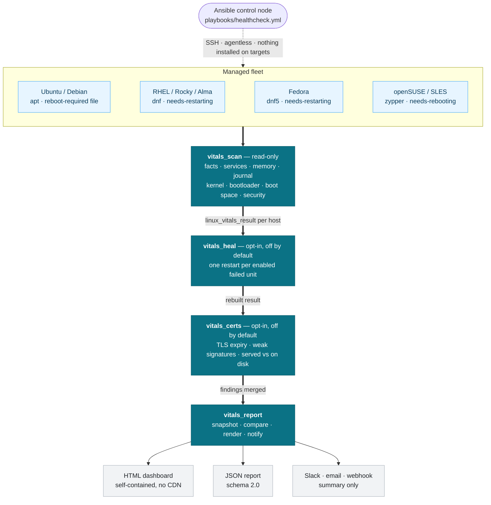

# Architecture

## Why four roles, one variable namespace

LinuxVitals is a single logical pipeline -- scan a host, optionally heal it,
optionally check its certificates, report on the fleet -- split into four
roles so each stage can be reused,
disabled, or run independently:



- **`vitals_scan`** gathers facts, journal/log posture, kernel and bootloader
  state, boot-partition health, security controls, and failed-login data,
  then builds one `linux_vitals_result` fact per host with a `final_status`
  (`Pass`/`Fail`) and a list of `findings`. It never changes anything on the
  managed host.
- **`vitals_heal`** is entirely gated by `linux_vitals_heal_enabled`
  (default `false`). When enabled, it attempts exactly one restart per
  systemd-enabled service found in a `failed` state, verifies each restart
  held (polled until the unit settles, then checked again after a stability
  window), then re-checks the required-service status and rebuilds
  `vitals_scan`'s `linux_vitals_result` so the report reflects the verified
  outcome -- the result object is built before this role runs, so without
  that rebuild the healing outcomes would never reach the dashboard. A
  restart whose outcome could not be verified becomes an `unknown`
  `service_manual_followup` finding, so remediation follows the same finding
  contract as detection.
  When disabled, its tasks are skipped but its role defaults still load, so
  `linux_vitals_heal_enabled` is always defined regardless of whether the
  role is present in a given play.
- **`vitals_certs`** is gated by `linux_vitals_certs_enabled`
  (default `false`) and is the only role that opens an outbound network
  connection: it checks TLS certificate expiry, weak signature algorithms,
  and whether what a host *serves* matches what is on its disk. It appends
  its findings to the host result `vitals_scan` already built, then
  re-includes `vitals_scan`'s `tasks/severity.yml` to recompute the host
  severity and `final_status` over the combined list -- sharing that file
  rather than reimplementing it is what keeps the two roles from drifting on
  what "critical" means. What it connects to, and why that is a trust
  boundary the other roles do not cross, is in
  [threat-model.md](threat-model.md#vitals_certs-the-only-role-that-opens-a-connection).
- **`vitals_report`** loads notification config (`.env` + inventory
  overrides), persists baseline/postcheck snapshots, computes the
  before/after comparison, renders the HTML dashboard and JSON report,
  archives historical reports, and sends Slack/email/generic-webhook
  summaries.

Unlike a typical Ansible Galaxy role, these four are deliberately **not**
independent -- they share one `linux_vitals_*` variable and fact namespace
instead of each having its own prefix (`vitals_scan_*`, `vitals_heal_*`,
...). That's a conscious tradeoff, not an oversight: `vitals_heal` needs to
read and overwrite fields `vitals_scan` produced (`healing_results`,
`services_healed`), `vitals_certs` appends to the same `findings` list and
recomputes the `final_status` built from it, and `vitals_report` needs to
read the full `linux_vitals_result` object as-is. A per-role prefix would
require a translation/mapping layer between every stage for no real benefit, since
the roles are always meant to be composed together (as
`playbooks/healthcheck.yml`, `baseline.yml`, and `postcheck.yml` all do).
`.ansible-lint` explicitly skips `var-naming[no-role-prefix]` for this
reason.

If you're consuming just `vitals_scan` in your own playbook (for example,
to build a different reporting pipeline), be aware that its
`linux_vitals_result` fact assumes `vitals_heal` either ran first or its
defaults are loaded -- `linux_vitals_healing_results` and
`linux_vitals_services_healed` are read with `| default([])` specifically
so `vitals_scan` stays safe to run standalone.

## Security boundaries

The trust boundaries this pipeline crosses -- managed host to control node,
control node to managed host, and control node to Slack/SMTP -- are documented
in [threat-model.md](threat-model.md), along with what each stage is permitted
to modify.

## Data flow

1. `vitals_scan` sets `linux_vitals_result` (a per-host fact) with a fixed
   schema: identity, kernel/bootloader, security, boot space, memory, logs,
   self-healing summary, `asset_serial`, `final_status`, `findings`,
   `unknown_count`, and a default `comparison: {baseline_available: false}`
   placeholder.
2. `vitals_heal`, if enabled, updates the self-healing-related facts that
   feed back into that same `linux_vitals_result` (rebuilt by `vitals_scan`
   in `tasks/result.yml`, which runs after `vitals_heal` in every shipped
   playbook).
3. `vitals_certs`, if enabled, runs after that rebuild and appends its own
   findings to `linux_vitals_result.findings`, then recomputes
   `final_status`, `unknown_count` and the host severity over the merged
   list by including
   `vitals_scan/tasks/severity.yml`. It is last in the scanning half for a
   reason: it is the only stage that can block on the network, so anything
   that must run regardless of a slow or unreachable TLS endpoint runs
   before it.
4. `vitals_report`:
   - `config.yml` resolves notification secrets/URLs from inventory,
     `group_vars`, extra vars, or a local `.env` (highest to lowest
     precedence in that order).
   - `snapshot.yml` persists `linux_vitals_result` as JSON under
     `linux_vitals_snapshot_dir/<maintenance_id>/<phase>/<host>.json` when
     `linux_vitals_phase` is `baseline` or `postcheck`. Before it writes any,
     it records the run's hosts in that directory's
     `.shards/<shard>.json` and checks them against what the shard was
     recorded with (see [below](#runs-that-share-a-directory)).
   - `compare.yml`, only in the `postcheck` phase, loads the matching
     baseline snapshot per host and merges a `comparison` object into
     `linux_vitals_result`. Findings are matched on `(id, subject)`, and a
     baseline written by 1.x -- plain-string findings -- is translated to
     ids first, so a window spanning the upgrade still compares correctly.
   - `render.yml` aggregates all per-host results (delegated to
     `localhost`, `run_once`) into `linux_vitals_summary`, then renders
     `dashboard.html.j2` and `report.json.j2`, and manages archive
     retention.
   - `notify.yml` sends the same summary through whichever channels are
     configured.

Today collection and evaluation both happen inside step 1: the discovery tasks
gather raw state and also decide several statuses from it (RAM, boot space,
kernel selection, AppArmor, bootloader match, reboot fallback); see
[the task layout](#vitals_scan-task-layout) for where. The raw state
on its own is specified as a separate, independently versioned document,
`state_schema: 1`, in [state-schema.md](state-schema.md). Nothing emits it
yet; it is the contract the collection/evaluation split
([#98](https://github.com/sameeralam3127/linux-vitals/issues/98)) builds
against. What step 1 produces for a given state is pinned by the golden-file
tests described in [testing.md](testing.md#golden-file-tests).

## `vitals_scan` task layout

`vitals_scan/tasks/main.yml` is three tasks: the check-mode gate, an
`include_tasks` of `discovery.yml`, and an `include_tasks` of `result.yml`,
which turns the discovered facts into findings and `linux_vitals_result`.

`discovery.yml` holds no checks of its own. It is the ordered list of the
files that do, one per concern, each brought in with `import_tasks`
([#27](https://github.com/sameeralam3127/linux-vitals/issues/27)). An import
is inlined when `discovery.yml` loads, so its tasks run exactly as if they
were written in `discovery.yml`: same order, same tags and conditions, and no
extra task per host. Anything written on an import itself, a tag or a `when`,
would be passed on to every task in its file, which is why none of the
imports carry any. `reboot_facts.yml` and `services.yml` predate the split
and are still dynamic `include_tasks`; `vitals_heal` also runs `services.yml`
after a restart.

The files run in three phases, in this order:

| # | File | What it does | Tags besides `discovery` |
| --- | --- | --- | --- |
| 1 | `facts.yml` | `setup`, `service_facts`, the distro context, the time-sync unit | -- |
| 2 | `log_errors.yml` | probe: journal entries at `linux_vitals_log_priority` or worse | -- |
| 3 | `login_records.yml` | probes: `lastb`, `who -b` | `security`; `boot` |
| 4 | `kernel.yml` | probe: latest installed kernel | `kernel` |
| 5 | `bootloader.yml` | probe: bootloader default entry | `kernel` |
| 6 | `reboot_probes.yml` | probes: the Debian, RedHat and SUSE reboot checks (one runs) | `kernel` |
| 7 | `security.yml` | probes: `getenforce`, `aa-status` | `security` |
| 8 | `rescue_image.yml` | probe: rescue images in `/boot` | `boot` |
| 9 | `kernel_install_failures.yml` | probe: kernel/bootloader failures in the journal | `kernel` |
| 10 | `pressure.yml` | probe: load average, CPU count, PSI, swap use and paging rate | `kernel`, `security`, `boot` |
| 11 | `journal_facts.yml` | whether each journal probe could read; counts and excerpts | `kernel`; `kernel`, `security`, `boot` |
| 12 | `memory.yml` | RAM usage | `kernel`, `security`, `boot` |
| 13 | `pressure_facts.yml` | CPU load, pressure stalls and swap: values and statuses | `kernel`, `security`, `boot` |
| 14 | `extended_facts.yml` | parses every probe into `linux_vitals_*` facts | `kernel`, `security`, `boot` |
| 15 | `reboot_facts.yml` (include) | whether a reboot is required, and why | `kernel` |
| 16 | `bootloader_facts.yml` | whether the default entry boots the latest kernel | `kernel` |
| 17 | `boot_space.yml` | the `/boot` mount and its free space | `boot` |
| 18 | `services.yml` (include) | the required-service status map | -- |

Where a file holds tasks with different tags, they are separated by `;` in
the order of the tasks. Every task also carries `discovery`, applied by
`main.yml` (see [Tags](#tags)).

**The order is load-bearing.** What each step needs to have run first:

- **Facts (1)** come first: everything after reads `ansible_facts`. Inside
  `facts.yml`, the time-sync unit is resolved from the service list the
  previous task builds.
- **Probes (2-10)** are read-only commands that register raw output and
  derive nothing. They read only `ansible_facts` and role variables, never
  another probe's result, so their relative order is not a dependency; it is
  kept as it was before the split.
- **Derived facts (11-18)** each read facts set above them:
  - `journal_facts.yml` reads both journal probes (2 and 9).
  - `pressure_facts.yml` reads the pressure probe (10), in three tasks:
    parse, values, then statuses.
  - `extended_facts.yml` reads `linux_vitals_ram_used_pct` from
    `memory.yml` and the output of probes 3 to 8.
  - `reboot_facts.yml` reads `linux_vitals_reboot_probe_output` and
    `linux_vitals_latest_kernel_selected`, and `bootloader_facts.yml` reads
    `linux_vitals_bootloader_default_*` and
    `linux_vitals_latest_installed_kernel`. `extended_facts.yml` sets all of
    them, so both run after it.
  - `services.yml` reads `linux_vitals_time_sync_service` from `facts.yml`.
  - `result.yml`, from `main.yml`, reads all of the above.
- **A `set_fact` cannot read a fact it sets itself.** Every value in the
  task is templated before any is set. So a fact that needs another fact is
  set by a later task: the two `set_fact` tasks in `facts.yml`, `memory.yml` before
  `extended_facts.yml`, the two in `bootloader_facts.yml` and in
  `boot_space.yml`, and the three in `reboot_facts.yml`. Merging any of these
  pairs into one task breaks it.

A new check belongs in its own file, imported from `discovery.yml` at the
point its inputs exist. `tests/test_scan_task_size.py` fails if a task file
in the role grows past 250 lines. The one exception is `bootloader.yml`,
whose single task embeds a 287-line shell script; it is pinned at its
current length.

## The finding object, and the finding contract

Every check that has something to report appends a finding. Since
[#8](https://github.com/sameeralam3127/linux-vitals/issues/8) and
[#62](https://github.com/sameeralam3127/linux-vitals/issues/62) the shape is:

```json
{ "id": "boot_space_low", "message": "...", "severity": "warning", "status": "fail" }
```

The `id` is the stable join key -- the runbook, the severity map
(`linux_vitals_finding_severities`), operator overrides
(`linux_vitals_finding_severity_overrides`), and any future export all key off
it, which is why rewording a `message` is a safe change and renaming an `id`
is not. Severity is resolved in one place, `vitals_scan/tasks/severity.yml`,
which `vitals_certs` includes rather than reimplements.

A check ends in one of three states, and the contract gives each exactly one
representation:

| The check... | It raises | Read as |
| --- | --- | --- |
| ran and found nothing wrong | no finding | clean |
| ran and found something wrong | a finding with `status: fail` (the default) | a problem |
| could not run -- a command missing, a file unreadable, a probe that timed out | a finding with `status: unknown` and a `reason` | nobody looked |

There is deliberately no `pass` finding. A finding is a record of something
needing attention, and every consumer -- the severity counts, the Slack
"needs attention" list, the comparison, anything downstream counting
`findings` -- would otherwise have to learn to skip passing ones.

`severity.yml` enforces the contract: it rejects any other status, and an
`unknown` finding without a `reason`. It then writes `status` onto every
finding, and counts the unknowns into the host's `unknown_count`. An unknown
finding is classified and counted against `linux_vitals_fail_on_severity`
like any other, so under the default threshold a check that could not run
fails the host. `final_status` stays `Pass` or `Fail`. Under a raised
threshold a host with an unknown check can pass, so the fleet health score
counts a host as healthy only if it passes **and** its `unknown_count` is
zero.

**The rule for new checks.** A check that shells out must tell "ran and found
nothing" from "could not run", and raise an `unknown` finding with a reason
for the second. `failed_when: false` on a probe, or `2>/dev/null` on its
command, is exactly how the two get conflated: the probe's failure becomes an
empty result, and an empty result reads as clean. That is the bug in
[#39](https://github.com/sameeralam3127/linux-vitals/issues/39), where a
missing `lastb` reports a host with no failed logins.
`tests/test_finding_contract.py` lists every scan probe that sets
`failed_when: false`, and fails when a new one appears, so the rule is
checked in review rather than remembered. The probes on that list predate
the contract and are audited against it one at a time, starting with #39.

## Why paths resolve from `inventory_dir`, not `playbook_dir`

Early in development, report output and the `.env` lookup were anchored to
`playbook_dir`. That works when you clone this repo and run
`playbooks/healthcheck.yml` directly, but breaks once the collection is
installed and invoked via FQCN
(`ansible-playbook sameeralam3127.linux_vitals.healthcheck`): `playbook_dir`
then resolves to wherever the collection package is installed, not the
operator's own project. Reports would try to write inside the installed
package (often read-only, and not where anyone would look for them), and
`.env` would never be found.

Every path that should live in *your* project -- `linux_vitals_output_path`,
`linux_vitals_json_output_path`, `linux_vitals_snapshot_dir`, and the `.env`
lookup -- is anchored to `inventory_dir` instead, since your inventory file
is reliably wherever your project actually is, regardless of how the
playbook was invoked.

## Runs that share a directory

Two runs often write to the same place: a cron schedule overlapping a manual
run, two inventories in CI, or a large fleet sharded into many runs
([performance.md](performance.md#sharding-a-large-fleet)). There is no lock.
What keeps them apart is which files each run writes, and how it writes them
([#26](https://github.com/sameeralam3127/linux-vitals/issues/26)).

- **Every write replaces the file.** Reports, archives, snapshots and shard
  manifests are all written by the `template` or `copy` module. Both write a
  temporary file in the destination directory and `rename()` it into place, so
  a reader, or another run, sees the old file or the new one, never a partial
  one. A run killed mid-write can leave a `tmp*` or `.ansible_tmp*` file in
  that directory. It is never at a report's path and is never pruned as an
  archive. Delete it if you find one. Keep it that way: a task that writes a
  report with `shell`, `lineinfile` or `unsafe_writes` breaks this, and
  `tests/test_concurrent_runs.py` fails on it.
- **Each run archives the report it rendered.** The archive is rendered from
  the template, not copied from `linux_vitals_output_path`, which may by then
  hold another run's report.
- **Retention pruning only matches this report's own archives:**
  `<stem>-<timestamp><ext>`, where the timestamp has the same shape as this
  run's. Another report's archives in the same directory are never matched,
  even when its name starts with this one's. Two runs pruning the same
  archives at once both succeed and leave the same newest
  `linux_vitals_report_retention_count`: deleting a file that is already gone
  is not an error, and an archive is only pruned when that many newer ones of
  the same report exist.
- **Each snapshot set records who wrote it.** A maintenance window's snapshot
  set (`<snapshot_dir>/<maintenance_id>/<phase>/`) can be written by several
  runs. Each records its hosts, once, in a manifest of its own,
  `.shards/<linux_vitals_snapshot_shard>.json`, or `.shards/default.json` when
  no shard id is set. Manifests are never rewritten, so no run ever modifies a
  file another run reads. A run whose hosts are all in its shard's manifest is
  a re-run, whole or `--limit`ed. A run that brings in hosts its shard was not
  recorded with fails before writing any snapshot if it named its shard, and
  warns if it did not.

| Shared by concurrent runs | Safe? |
| --- | --- |
| One report and archive directory, a different `linux_vitals_output_path` and `linux_vitals_json_output_path` per run | Yes. |
| One `linux_vitals_output_path` | The latest report is the last run's, and always complete. Each run archives its own report, but two runs that start rendering in the same second get the same archive name and only the later is kept. Give concurrent runs their own output paths. |
| One snapshot directory and maintenance id, a different `linux_vitals_snapshot_shard` per run | Yes. A shard id reused for other hosts fails the run. Shards may overlap; a host in two shards keeps the snapshot of whichever wrote it last. |
| One snapshot directory and maintenance id, no shard ids | Nothing is corrupted, since snapshots are per host, but the runs cannot be told apart: a run with hosts the first run did not record gets a warning, not an error. This is how every release before shard ids behaved, apart from the warning, and sequential per-group runs rely on it. |
| One shard id, two runs recording it at the same moment | Both can find no manifest and write one, and the later write wins. The earlier run reads the manifest back in its next task, sees the other run's hosts and reports the conflict. Neither notices only if the later run stalls between its existence check and its rename, a few lines apart in one module call, for longer than the earlier run takes to read the manifest back. |

A snapshot set written before shard manifests existed has host snapshots and
no `.shards/`. Which run wrote them cannot be checked, so the first run to
reach it records its own manifest, goes ahead, and names any of those
snapshots it does not overwrite.

## Tags

`vitals_scan` and `vitals_report`'s task files are included with
`include_tasks: ... apply: tags: [...]`. The `tags` on the include decide
whether the file is loaded at all, and are not inherited; `apply: tags` adds
its tags to every task in the file, alongside the task's own. So every
discovery task, whichever file `discovery.yml` imports it from, carries
`discovery`, while specific tasks additionally carry `kernel`, `security`, or
`boot` so `--tags kernel` (etc.) runs a slice instead of the whole scan. The
`always` tag on `vitals_report`'s `config.yml` ensures notification
configuration loads even when you run a narrowly-tagged subset.

A tagged run has only the facts set by tasks that ran. A task that reads a
fact set by a task without the same tag fails on an undefined variable, which
is the bug [#16](https://github.com/sameeralam3127/linux-vitals/pull/16) fixed
for the bootloader facts. `tests/test_tagged_scan.py` runs the role over the
golden fixtures under each selection the docs suggest, and three of them stop
on exactly this today. They predate the #27 split, which left them alone
because fixing them changes behaviour; the test pins where each one stops:

- `--tags kernel,reporting` stops in `journal_facts.yml`, which reads
  `linux_vitals_journalctl`, registered by `log_errors.yml`, tagged
  `discovery` only.
- `--tags security,reporting` and `--tags boot,reporting` stop in
  `result.yml`, which reads `linux_vitals_service_status` from `services.yml`,
  tagged `discovery` only. On ansible-core 2.16 they stop earlier, in
  `extended_facts.yml`, on `linux_vitals_bootloader_default_cmd`, which only
  the `kernel`-tagged bootloader probe registers.

Adding `discovery` to a selection runs the whole scan, and works:
`--tags discovery,kernel,reporting`.

## Fact cache lifetime

The checkout keeps platform facts in `.facts/` for up to one hour
(`fact_caching_timeout = 3600`). This lets nearby runs reuse facts without
falling back to Ansible's 24-hour default. Discovery still refreshes its
`min`, `hardware`, `network`, and `virtual` subsets and reruns health probes.
A report-only run does not perform a fresh scan.

Expiry is checked when entries are read; it does not remove files for retired
hosts on a schedule. See [cached facts](troubleshooting.md#cached-facts) for
cold runs and cleanup. This `ansible.cfg` is not shipped in the Galaxy
collection, so Galaxy users keep their own cache settings.
