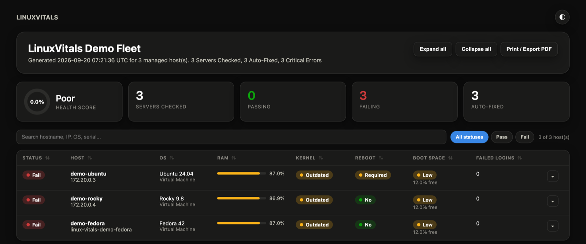
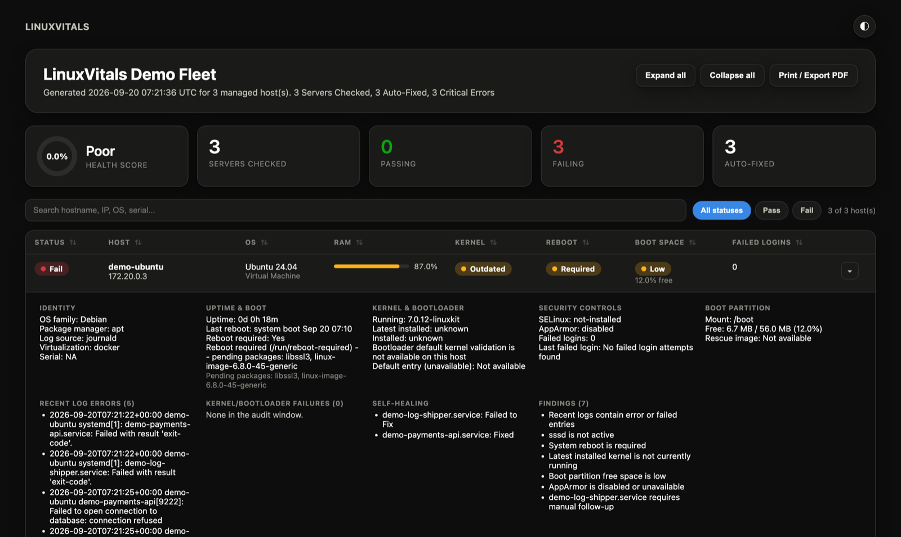

# Report Guide

LinuxVitals produces an HTML dashboard, a JSON report, and (when
baseline/postcheck snapshots exist) per-host JSON snapshots. Their default
paths are under `reports/` next to your inventory. Optional Prometheus
textfile and CSV exports are disabled until you configure their paths.

## HTML dashboard

`reports/linux_vitals_report.html` -- self-contained (no external CSS/JS,
no CDN), works offline, opens in any browser.

[](images/dashboard-overview.png)

The screenshots on this page come from the [demo fleet](../demo/README.md) and
are regenerated by `demo/screenshots.sh`, so they track the current templates.

**Header.** Report title, generated timestamp, and -- for `baseline` /
`postcheck` runs -- a phase badge and the maintenance id, so you can tell
at a glance which run you're looking at.

**KPI row.** Servers checked, a health-score ring (the percentage of hosts
that pass *and* had every check run, banded Excellent ≥95% / Good ≥80% /
Fair ≥60% / Poor <60%), passing/failing counts, hosts with unknown checks
(see [Status](#status-when-a-check-could-not-run)), and auto-fixed count. On a `postcheck` run, three more tiles
appear: Improved, Regressed, New hosts (hosts with no matching baseline
snapshot).

**Toolbar.** A free-text search box (matches hostname, IP, OS, and serial
number), status filter chips (All / Pass / Fail), and -- on `postcheck`
runs -- comparison filter chips (All / Regressed / Improved / New). Expand
all / Collapse all buttons and a Print / Export PDF button (uses the
browser's native print dialog; "Save as PDF" there gives you an offline
copy).

**Host table.** One row per host, sortable by clicking any column header
(click again to reverse). Click the chevron (or the row) to expand an
inline detail panel with everything the summary row doesn't show. A host
with checks that could not run carries an `N unknown` pill beside its
Pass/Fail status. Under each RAM meter, one line shows the host's saturation
signals ([#34](https://github.com/sameeralam3127/linux-vitals/issues/34)): the 5-minute load per CPU, the worst pressure stall
and the swap rate, each with a dot coloured by its status. `n/a` means not
measurable on that host (no PSI, or swap sampling off); `?` means the check
could not run.

- Identity (OS family, package manager, log source, virtualization type,
  serial number)
- Uptime and last reboot
- Kernel and bootloader validation (running vs. latest installed kernel,
  whether the default boot entry actually selects it)
- Security controls (SELinux/AppArmor status, failed login count and most
  recent attempt)
- Boot partition free space and rescue image availability
- Recent log errors and kernel/bootloader-related failures (with excerpts)
- Self-healing actions taken this run, with why any restart was not fixed.
  One that could not be verified is marked `unknown`
- Failed units ([#32](https://github.com/sameeralam3127/linux-vitals/issues/32)): every systemd unit `service_facts` reports as
  failed, next to self-healing since that is what a self-healing attempt
  would have acted on
- Findings -- the specific reasons a host failed, if any. A check that could
  not run is marked `unknown`, followed by why
- On `postcheck` runs with a baseline available: status/RAM/kernel/reboot
  before vs. after, plus new and resolved findings

[](images/dashboard-host-detail.png)

**Theme.** Follows your OS light/dark preference by default; the toggle in
the top-right corner overrides it (stored via `localStorage` where
available). The print stylesheet forces a light, borderless layout
regardless of theme.

**Scaling to hundreds of hosts.** The table renders every host's row and
detail panel up front (search/filter/sort are pure client-side DOM
operations, no server round-trip), which keeps the file self-contained at
the cost of a larger HTML file for very large fleets. Search and filtering
keep the working view small even when the underlying table is large. What the
*run* costs at that size, and how to measure it, is in
[performance.md](performance.md).

## JSON report

`reports/linux_vitals_report.json` -- schema `2.4`, intended for ingestion
by log shippers, SIEMs, or your own dashboards.

```json
{
  "schema_version": "2.4",
  "generated_at": "20260712T120000Z",
  "report": { "title": "...", "html_output_path": "...", "json_output_path": "..." },
  "maintenance": { "phase": "postcheck", "maintenance_id": "2026-07-12-patch-window" },
  "summary": {
    "overall_status": "FAIL",
    "servers_checked": 5,
    "auto_fixed_count": 1,
    "critical_error_count": 1,
    "failing_host_count": 1,
    "health_score_pct": 80.0,
    "health_score_band": "Good",
    "unknown_host_count": 0,
    "unreported_host_count": 1,
    "missing_postcheck_count": 1,
    "unreported_hosts": [
      {"inventory_name": "db03", "status": "Unknown", "reason": "no health result was produced for this host; it was unreachable, or the play failed on it before vitals_scan built one", "baseline_available": true}
    ],
    "comparison_active": true,
    "baseline_max_age_hours": 72,
    "stale_baseline_count": 1,
    "unknown_baseline_age_count": 0,
    "regressed_count": 1,
    "improved_count": 1,
    "new_hosts_count": 2,
    "snippet": "5 Servers Checked, 1 Auto-Fixed, 1 Failing Host"
  },
  "hosts": [
    {
      "inventory_name": "web01",
      "hostname": "web01",
      "ip_address": "192.0.2.11",
      "status": "Pass",
      "os": { "distribution": "Ubuntu 24.04", "family": "Debian", "package_manager": "apt", "log_source": "journald" },
      "platform": { "type": "Virtual Machine", "virtualization_type": "kvm", "uptime": "12d 4h 21m", "last_reboot": "2026-06-30 08:15" },
      "kernel": { "running": "6.8.0-60-generic", "latest_installed": "6.8.0-60-generic", "latest_selected": true, "install_failures": 0, "install_failure_excerpt": [] },
      "bootloader": { "supported": true, "default_status": "resolved", "default_matches_latest": true, "validation_message": "Default boot entry selects the latest installed kernel" },
      "reboot": { "required": false, "detection_supported": true, "source": "reboot-required-file", "pending_packages": [], "reason": "No reboot required (reboot-required-file)" },
      "security": { "selinux_status": "not-installed", "apparmor_status": "enabled", "failed_login_count": 0, "last_failed_login": "No failed login attempts found", "firewall": {"active": true, "detection_supported": true, "source": "ufw", "detail": "Status: active"}, "ssh_hardening": {"detection_supported": true, "source": "sshd-T", "permit_root_login": "no", "password_authentication": "no", "permit_empty_passwords": "no"}, "kernel_taint": {"value": 0, "supported": true, "reasons": []}, "reboot_blocking_processes": {"supported": true, "source": "lsof", "processes": []} },
      "boot_space": { "mount": "/boot", "free_pct": 65.3, "status": "Healthy", "rescue_image_available": true, "rescue_image_paths": ["..."] },
      "memory": { "status": "OK", "used_pct": 42.5, "used_mb": 3480.0, "total_mb": 8192.0 },
      "filesystems": { "worst_status": "Warning", "worst_mount": "/var", "mounts": [
        { "mount": "/", "fstype": "ext4", "size_used_pct": 42.5, "size_used_mb": 8500.0, "size_total_mb": 20000.0, "inode_used_pct": 12.0, "inode_total": 1310720, "inode_available": 1153433, "read_only": false, "expected_readonly": false, "status": "OK", "reason": null },
        { "mount": "/var", "fstype": "ext4", "size_used_pct": 88.1, "size_used_mb": 8810.0, "size_total_mb": 10000.0, "inode_used_pct": 15.0, "inode_total": 655360, "inode_available": 557056, "read_only": false, "expected_readonly": false, "status": "Warning", "reason": null }
      ] },
      "pressure": { "cpu_count": 4, "load": {"1m": 0.4, "5m": 0.36, "15m": 0.3}, "load_per_cpu": {"1m": 0.1, "5m": 0.09, "15m": 0.08}, "load_status": "OK", "psi_supported": true, "psi": {"cpu_some": 0.85, "memory_some": 0.0, "memory_full": 0.0, "io_some": 0.42, "io_full": 0.11}, "psi_status": "OK", "stalled": [], "swap_total_mb": 2048.0, "swap_used_mb": 0.0, "swap_used_pct": 0.0, "swap_sample_seconds": 2, "swap_in_per_sec": 0, "swap_out_per_sec": 0, "swap_rate_per_sec": 0, "swap_status": "OK", "load_reason": "", "psi_reason": "", "swap_reason": "" },
      "logs": { "error_count": 0, "excerpt": [] },
      "self_healing": { "services_healed": ["chronyd.service"], "healing_results": [{ "service": "chronyd.service", "result": "Fixed", "outcome": "fixed", "reason": "stayed_active", "detail": "it stayed active for 5 s after the restart" }], "skipped_by_policy": [{ "service": "postgresql.service", "reason": "excluded", "detail": "it matches linux_vitals_heal_exclude_services" }] },
      "failed_units": { "count": 1, "units": [{"name": "payments-api.service", "enabled": true}] },
      "asset_serial": "VMware-56 4d 2a",
      "comparison": {
        "baseline_available": true,
        "baseline_captured_at": "2026-07-11T10:00:00Z",
        "baseline_age_hours": 26.0,
        "baseline_age_unknown": false,
        "baseline_age_warning": false,
        "status_before": "Fail",
        "status_after": "Pass",
        "status_improved": true,
        "status_regressed": false,
        "ram_used_pct_delta": -45.5,
        "kernel_changed": true,
        "new_findings": [],
        "resolved_findings": [
          {"id": "ram_critical", "message": "RAM usage is critical", "severity": "critical", "status": "fail"}
        ],
        "severity_before": "critical",
        "severity_after": "none"
      },
      "severity": "none",
      "severity_counts": {"info": 0, "warning": 0, "critical": 0},
      "unknown_count": 0,
      "findings": []
    }
  ]
}
```

`critical_error_count` remains for compatibility and continues to count hosts
whose final status is `Fail`, regardless of finding severity. The clearer
`failing_host_count` alias reports the same number. Use
`findings_by_severity.critical` to count critical findings.

Schema `2.1` was additive over `2.0`: every finding gains `status` (and
`reason` when the status is `unknown`), each host gains `unknown_count`, the
summary gains `unknown_host_count`, `failing_host_count` (an alias for the
existing `critical_error_count`), `baseline_max_age_hours`,
`stale_baseline_count` and `unknown_baseline_age_count`, and each
`healing_results` entry gains `outcome`, `reason` and `detail`. A postcheck
comparison with a baseline gains its capture timestamp, age and age flags.
Each host also gains `pressure`
([#34](https://github.com/sameeralam3127/linux-vitals/issues/34)),
`filesystems` ([#30](https://github.com/sameeralam3127/linux-vitals/issues/30))
and `failed_units`
([#32](https://github.com/sameeralam3127/linux-vitals/issues/32)). Nothing
was removed or renamed, and no existing field changed type or meaning.

`2.2` is additive over `2.1`: every finding gains `references`
([#43](https://github.com/sameeralam3127/linux-vitals/issues/43)), a list of
exact external control identifiers the finding maps to, such as a CIS or STIG
rule number -- see [Findings](#findings) below. It is `[]` on every finding
that has no exact mapping, which as of this release is every finding this
collection ships: the field exists so a consumer can join on it, but no
mapping is populated yet, deliberately -- an approximate or guessed control
number would be worse than none on something an audit might quote.

`2.3` is additive over `2.2`: `self_healing` gains `skipped_by_policy`
([#148](https://github.com/sameeralam3127/linux-vitals/issues/148)), the
failed, enabled units a restart was never attempted on because a guardrail
ruled them out -- see
[Units self-healing did not attempt](#units-self-healing-did-not-attempt). It
is `[]` on a run that configured no guardrails, which is every run before
this release. Nothing was removed or renamed, and `healing_results` keeps its
shape and its three `result` values.

`2.4` is additive over `2.3`: the summary gains `unreported_host_count`,
`unreported_hosts` and `missing_postcheck_count`
([#147](https://github.com/sameeralam3127/linux-vitals/issues/147)) -- the
hosts the play targeted that produced no result at all. Nothing was removed or
renamed, no field changed type, and `overall_status` keeps its two values. The
one outcome that changes is the verdict on a run where a host could not be
scanned: it was `PASS` with the host omitted, and is now `FAIL` with the host
named. Those runs already exited non-zero. See
[Hosts that were not checked](#hosts-that-were-not-checked).

`pressure` holds the CPU load, pressure stall and swap values the scan read,
and a status for each of the three checks:

- `load`, `load_per_cpu`: the 1, 5 and 15-minute load averages, raw and divided
  by `cpu_count` (online CPUs). `load_status` is judged on the 5-minute value.
- `psi`: PSI `avg60` percentages: the share of the last minute in which at least
  one task (`*_some`) or every task (`*_full`) was stalled on CPU, memory or I/O.
  `stalled` lists the resources at or above the warning threshold, worst first.
- `swap_*`: swap size and use, and the pages swapped in and out per second
  between two reads `swap_sample_seconds` apart.
- Each `*_status` is `OK`, `Warning` or `Critical` by threshold, or:
  - `Unknown`: it could not be read, and `*_reason` says why;
  - `Unsupported` (PSI): no PSI on this kernel; `psi` is `null` and `psi_reason` gives the kernel's answer;
  - `Not sampled` (swap): `linux_vitals_swap_sample_seconds` is `0`.

  A value that could not be measured is `null`, never `0`.

`filesystems` ([#30](https://github.com/sameeralam3127/linux-vitals/issues/30))
holds one entry per in-scope mount -- every real filesystem except the
pseudo/network ones listed in `linux_vitals_disk_exclude_fstypes` (`tmpfs`,
`proc`, `nfs`, and the like), plus/minus anything named in
`linux_vitals_disk_include_mounts` / `_exclude_mounts`:

- `worst_status`, `worst_mount`: the single worst entry below, for a
  dashboard or alert that only wants one number per host. `worst_status` is
  `None` only when `mounts` is empty; `worst_mount` is an empty string in
  that case, by design, never `null` -- a bare top-level `null` leaf is
  rendered as an empty string on ansible-core 2.16's default templating
  anyway, so the report standardises on empty string for this one field
  rather than depending on which core produced the report.
- `mounts[]`: `mount`, `fstype`, `size_used_pct`/`size_used_mb`/`size_total_mb`,
  `inode_used_pct`/`inode_total`/`inode_available`, `read_only`,
  `expected_readonly`, a per-mount `status` (`OK`, `Warning`, `Critical` or
  `Unknown`), and `reason` when `status` is `Unknown`.
- As with `pressure`, a value that could not be read is `null`, never `0`.

A `/boot` entry with no size data used to compute 0% free and wrongly raise
`boot_space_low`; that case now resolves `boot_space.status` to the existing
`Not Available` value instead, and the `filesystems` entry for `/boot` raises
`filesystem_unavailable` so the gap is still visible.

`comparison` is always present with at least `baseline_available`; on
`adhoc`/`baseline` runs, or for a host with no matching baseline snapshot,
it's `{"baseline_available": false}` and the rest of the comparison fields
are absent.

On a postcheck with a baseline, `comparison.baseline_captured_at` is its UTC
capture time or `null` when the timestamp is missing or malformed;
`baseline_age_hours` is its age rounded to one decimal place or `null` when
unknown; `baseline_age_unknown` marks snapshots without a valid capture time;
and `baseline_age_warning` marks ages over
`linux_vitals_baseline_max_age_hours` (72 by default). The summary's
`baseline_max_age_hours` reports that configured limit,
`stale_baseline_count` counts baselines over a positive limit, and
`unknown_baseline_age_count` counts baselines without a valid timestamp. An age
warning appears in run output and in the dashboard; setting the limit to `0`
disables warnings for dated baselines, while undated baselines remain explicitly
unknown.

## Hosts that were not checked

A host that was unreachable, or that the play failed on before `vitals_scan`
built its result, is **not** in `hosts`. It never produced any of the fields
that array carries. It is named in the summary instead:

```json
"unreported_host_count": 2,
"missing_postcheck_count": 1,
"unreported_hosts": [
  {"inventory_name": "db03", "status": "Unknown", "reason": "no health result was produced for this host; it was unreachable, or the play failed on it before vitals_scan built one", "baseline_available": true},
  {"inventory_name": "web07", "status": "Unknown", "reason": "no health result was produced for this host; it was unreachable, or the play failed on it before vitals_scan built one", "baseline_available": false}
]
```

| Field | Meaning |
| --- | --- |
| `inventory_name` | The host as the inventory names it. Nothing else about it was read, so there is no `hostname` or `ip_address` to give. |
| `status` | Always `Unknown`. The same word a check that could not run uses: nobody looked, which is neither pass nor fail. |
| `reason` | Why there is no result. Ansible reports an unreachable host and a host that failed mid-play the same way to the controller, so one reason names both. |
| `baseline_available` | `postcheck` only: a baseline snapshot for this host exists under this `maintenance_id`, so it was scanned before the window and is silent after it. `false` outside `postcheck`. |

`status` is `Unknown` here and never appears in `hosts[].status`, which keeps
its two values `Pass` and `Fail`. A consumer branching on those is unaffected;
one that wants the whole targeted fleet reads `hosts` and `unreported_hosts`
together. `servers_checked` still counts the hosts that produced a result, so
`servers_checked + unreported_host_count` is what the play set out to scan.

**The health score counts them.** `health_score_pct` is the percentage of
*targeted* hosts that pass with no unknown checks -- not the percentage of
hosts that answered. Ten hosts baselined, patched and rebooted, three of which
never come back, scores 70 %, not 100 %: the three hosts whose outcome is
least known cannot raise the number by leaving the sum. `overall_status` is
`FAIL` whenever `unreported_host_count` is above zero, for the same reason.

**The gates count them.** `linux_vitals_fail_on_status: any_fail` counts
`failing_host_count + unreported_host_count`. `regression` counts
`regressed_count + missing_postcheck_count` -- a host with no baseline cannot
have regressed, and `any_fail` is the gate that catches it.

Where to look: the dashboard has a **Not checked** tile and, above the host
table, a panel naming each host; the Slack message has a `Not checked` counter
and block; the generic webhook payload carries all three summary fields; the
CSV export gets one row per host with `status` `Unknown`; and the Prometheus
export has `linux_vitals_unreported_hosts`.

A run where *every* host is unreachable produces no report at all. The role's
rendering tasks are `run_once` and need one host left in the play to run on,
and `ansible-playbook` exits non-zero. That is the one case the report cannot
describe, because nothing is left to describe it from.

## Optional Prometheus textfile and CSV exports

Both exports use the current `linux_vitals_result_list` already assembled by
`vitals_report`. They run once on the Ansible controller, do no discovery,
and add no HTTP endpoint or additional host checks. The HTML and JSON outputs
keep their existing formats. Enable either export independently:

```yaml
linux_vitals_metrics_output_path: "/var/lib/node_exporter/textfile_collector/linux_vitals.prom"
linux_vitals_csv_output_path: "{{ inventory_dir }}/reports/linux_vitals_report.csv"
```

Both variables default to `""` (off). Use distinct paths for metrics, CSV,
HTML and JSON, and distinct paths for concurrent runs. Resolved export paths
that collide with each other or the HTML/JSON paths are rejected. The role
creates parent directories with `linux_vitals_report_dir_mode` and writes
files with `linux_vitals_report_file_mode`; defaults are `"0755"` and
`"0644"`. Give the automation user write access and the chosen reader access.
Exports overwrite their configured files on each run and are not archived or
pruned by the HTML/JSON archive settings. Disabling or changing an export path
does not delete its old file: remove obsolete exports explicitly.

### Prometheus textfile collector

The `.prom` file uses [Prometheus text exposition format 0.0.4](https://prometheus.io/docs/instrumenting/exposition_formats/),
with HELP/TYPE lines and no sample timestamps; it is not full OpenMetrics.
Configure an existing [node_exporter textfile collector](https://github.com/prometheus/node_exporter#textfile-collector)
on the controller to read the directory above, for example by adding
`--collector.textfile.directory=/var/lib/node_exporter/textfile_collector`
to its service command. This role does not install or configure node_exporter.
A Prometheus configuration for node_exporter running on that same machine is:

```yaml
scrape_configs:
  - job_name: linux_vitals_controller
    static_configs:
      - targets: ["localhost:9100"]
```

If Prometheus runs elsewhere, replace `localhost` with the controller's
reachable node_exporter address. The scrape target represents the controller;
the `host` label identifies the checked host. Per-host metrics have labels
`host`, `ip_address`, `os_family` and `phase`. Two results with the same
`(hostname, ip_address, os_family)` are rejected when metrics are enabled,
to avoid duplicate samples; CSV alone does not impose that identity check.

| Gauge | Meaning |
| --- | --- |
| `linux_vitals_host_status` | `1` only for `Pass` with zero unknown checks; otherwise `0`. |
| `linux_vitals_unknown_checks` | Checks that could not run for this host. |
| `linux_vitals_findings` | Current findings by `severity` (`info`, `warning`, `critical`) and `status` (`fail`, `unknown`), including zero-valued combinations. A gauge of what the current report holds, not a cumulative counter -- hence no `_total` suffix. |
| `linux_vitals_ram_used_pct` | RAM used percentage; `NaN` when unavailable. |
| `linux_vitals_reboot_required` | `1` required, `0` not required, `NaN` for an explicit unknown reboot finding or null reboot result. An unsupported distro-specific detector still uses the existing kernel fallback; unsupported alone does not mean `NaN`. |
| `linux_vitals_unreported_hosts` | Hosts this run targeted that produced no health result -- unreachable, or failed mid-play. They have no hostname, IP or OS family, so there is no per-host series for them; above zero means some hosts are described by nothing else in the file. Only the `phase` label is present. |
| `linux_vitals_health_score_pct` | Percentage of *targeted* hosts that are `Pass` with zero unknown checks, rounded to one decimal; `0` for an empty fleet. Unreported hosts are in the denominator, so a host that dropped out lowers it. Only the `phase` label is present. |

For example, a healthy host and the fleet score might emit:

```text
# HELP linux_vitals_host_status 1 when the host passes and every check could run, otherwise 0.
# TYPE linux_vitals_host_status gauge
linux_vitals_host_status{host="web01",ip_address="192.0.2.11",os_family="Debian",phase="adhoc"} 1
# HELP linux_vitals_health_score_pct Percentage of targeted hosts that pass with no unknown checks in this report.
# TYPE linux_vitals_health_score_pct gauge
linux_vitals_health_score_pct{phase="adhoc"} 100.0
```

These are run snapshots, not continuously refreshed host measurements.
Prometheus scrape time does not establish when the scan ran. Monitor
node_exporter's `node_textfile_mtime_seconds` for the file and alert on an age
appropriate to your scan schedule. An old `.prom` file remains scrapeable if a
run fails or metrics are disabled; remove it explicitly when retiring the
export. Phase is a label, so a new run with another phase replaces the file's
previous phase samples rather than preserving history in the file.

### CSV fleet table

The CSV has one header and one row per host, in this fixed 22-column order:

```text
status,unknown_count,hostname,ip_address,os,os_family,platform_type,phase,ram_used_pct,load_per_cpu_5m,load_status,psi_some_max_pct,psi_status,swap_rate_per_sec,swap_status,kernel_status,reboot_required,reboot_detection_supported,boot_space_status,boot_free_pct,failed_login_count,change
```

Missing optional measurements are blank, not zero. Pressure status columns
retain values such as `Unknown`, `Unsupported` and `Not sampled`.
`psi_some_max_pct` is the largest CPU, memory or I/O `some` percentage.
`kernel_status` is `Current` or `Outdated`; `reboot_required` is `Required`,
`No` or `Unknown`, and `reboot_detection_supported` is `true` or `false`.
`change` is blank outside `postcheck`; during `postcheck` it is `New`,
`Regressed`, `Improved`, `Unchanged` according to the existing comparison, or
`Missing` for a host that produced no result.

A host the play targeted that produced no result gets a row too, after the
rest ([#147](https://github.com/sameeralam3127/linux-vitals/issues/147)): a
fleet table that drops it is the bug. Its `status` is `Unknown`, `hostname`
holds the inventory name -- the only identity available for a host nobody
reached -- `reboot_required` is `Unknown`, and every measured column is blank,
because nothing was measured.

Every cell is double-quoted and embedded quotes are doubled, so commas,
quotes and line breaks in text remain within one cell. Text starting with
`=`, `+`, `-`, `@`, tab, carriage return or newline receives a leading
apostrophe to prevent spreadsheet formula interpretation. This protection
intentionally changes those text cells and is not reversible without knowing
the original value. Use the JSON report when exact original strings are
needed. Numeric values do not receive the prefix. Use a CSV parser rather
than splitting on commas or lines.

## Self-healing outcomes

When `vitals_heal` is enabled, each restart it attempts is one entry in
`self_healing.healing_results`. A restart is not judged from one look:
each unit is polled until it is active, failed or inactive, and a unit that
came up must still be active, on the same run, after
`linux_vitals_heal_stability_seconds` (see
[configuration-reference.md](configuration-reference.md#self-healing)).

```json
{"service": "app.service", "result": "Failed to Fix", "outcome": "still_failed", "reason": "failed", "detail": "it came up, then failed within 5 s (result: exit-code)"}
```

`result` has the same three values it always had, so code that reads only
`result` still reads every entry correctly: only a verified fix is `Fixed`.
`outcome` says which of three states the attempt ended in, and `reason` why:

| `result` | `outcome` | `reason` | Means |
| --- | --- | --- | --- |
| `Fixed` | `fixed` | `stayed_active` | Active after the restart and still on the same run after the stability window |
| `Failed to Fix` | `still_failed` | `failed` | Failed again: at once, within the stability window, or because its start job failed and the restart command reported it (`detail` then says so) |
| `Failed to Fix` | `still_failed` | `restarted_during_check` | Active at both looks, but systemd restarted it in between: it crashed and its `Restart=` policy brought it back |
| `Manual Intervention Required` | `still_failed` | `restart_error` | The restart command failed without leaving a failed unit behind -- the unit was not found, or its state could not be read. `detail` carries the error |
| `Manual Intervention Required` | `still_failed` | `inactive` | It is not running after the restart, but did not fail either |
| `Manual Intervention Required` | `unknown` | `not_settled` | Still activating, deactivating or reloading when the settle budget ran out |
| `Manual Intervention Required` | `unknown` | `check_failed` | Its state could not be read after the restart |

`unknown` means the check could not complete, so nobody knows whether the
restart worked. It is never reported as `Fixed`, and its
`service_manual_followup` finding has `status: unknown` with `detail` as its
`reason`. `detail` is a sentence for a human and may be reworded in any
release; join on `reason`. An entry written before 2.2.0 has only `service`
and `result`.

`auto_fixed_count` and `services_healed` count `Fixed` entries only.

### Units self-healing did not attempt

`self_healing.skipped_by_policy` lists the units that were failed and enabled
at boot -- so a restart would otherwise have been attempted -- but that a
guardrail ruled out
([#148](https://github.com/sameeralam3127/linux-vitals/issues/148)). They have
no `healing_results` entry, because nothing was attempted and there is no
outcome to report.

```json
{"service": "postgresql.service", "reason": "excluded", "detail": "it matches linux_vitals_heal_exclude_services"}
```

| `reason` | Means |
| --- | --- |
| `excluded` | It matches `linux_vitals_heal_exclude_services` |
| `not_included` | It matches nothing in `linux_vitals_heal_include_services` |
| `outside_window` | The managed host's clock was outside `linux_vitals_heal_window_start`-`linux_vitals_heal_window_end`. Decided per host, so every in-scope unit on it is skipped |
| `window_unknown` | A window is configured but the host's clock could not be read, so the host was left alone |
| `over_max_restarts` | More units were in scope than `linux_vitals_heal_max_restarts` allows, so none was restarted -- not the first N |

This is what tells "self-healing tried and could not" from "self-healing never
tried", which the absence of a `healing_results` entry cannot. `detail` is a
sentence for a human and may be reworded in any release; join on `reason`.
The field is always present from schema 2.3 and is an empty list on a run that
set no policy. A skipped unit keeps whatever findings the scan raised for it --
a guardrail suppresses the restart, not the report, so it is still in
`failed_units` and still fails its required-service check if it is one.

## Failed units

`failed_units.units` lists every systemd unit `service_facts` reports as
failed, not just the required services this collection names by default
([#32](https://github.com/sameeralam3127/linux-vitals/issues/32)). Units
that are disabled, masked, static, or missing a unit file are excluded --
those are intentionally not running, so they would otherwise make the count
"every stopped unit on the host" rather than something operational.

```json
{"name": "payments-api.service", "enabled": true}
```

`enabled` is `true` only for a unit `service_facts` could affirmatively
confirm is enabled, enabled at runtime, or indirectly enabled. A unit that
crashed into systemd's `failed` state can lose its own unit-file
enabled/disabled information in `service_facts` -- that is still listed in
`failed_units.units` and counted in `failed_units.count`, but with
`enabled: false`, since it could not be confirmed. The `failed_units_present`
finding fires on the count of entries with `enabled: true`, so a fleet of
disabled-but-stopped units never drowns out the ones worth paging on.

## Findings

What to *do* about each of these is in the [Operator Runbook](runbook.md).

Every finding is an object with a stable `id`, a human `message`, a
`severity`, a `status`, and a `references` list:

```json
{"id": "reboot_required", "message": "System reboot is required", "severity": "warning", "status": "fail", "references": []}
```

The `id` is the durable one. It is what severity is keyed on and what an
external system should join against -- `message` wording can change in any
release without that being a breaking change.

`references` ([#43](https://github.com/sameeralam3127/linux-vitals/issues/43))
names the exact external control identifiers this finding maps to, such as a
CIS or STIG rule number, for example `["CIS-DIL-<section>"]`. It is populated
only where a mapping is exact; most findings carry an empty list, and that is
the correct, intended outcome, not a gap -- an approximate control number is
worse than none on something an audit might quote. No mapping is published
with this release; the field exists so a consumer can join on it once one is.

A finding that can occur more than once on a host also carries `subject`: the
unit for the self-healing finding, the path or `host:port` for certificate
findings. An id alone is therefore not unique within a host -- join on
`(id, subject)`, treating a missing `subject` as empty. That pair is what the
baseline/postcheck comparison diffs on, so a service that newly fails while
another was already failing is reported as new.

### Status: when a check could not run

A finding's `status` says which of two things it records:

| `status` | Means | Extra field |
| --- | --- | --- |
| `fail` | The check ran and found something wrong | -- |
| `unknown` | The check could not run, so nothing is known either way | `reason`: why, e.g. `reading /var/log/btmp was denied; this check needs become` |

```json
{"id": "failed_logins", "message": "Failed login attempts could not be inspected", "severity": "info", "status": "unknown", "reason": "reading /var/log/btmp was denied; this check needs become"}
```

A check that ran and found nothing raises no finding at all, so there is no
`pass` status. A finding without a `status` -- from a snapshot written
before 2.2.0 -- means `fail`.

An `unknown` finding is classified and counted like any other, so under the
default `linux_vitals_fail_on_severity` it fails the host: a host nobody
could fully check is not reported as clean. Each host's `unknown_count` says
how many of its checks could not run, and the summary's `unknown_host_count`
how many hosts had at least one. Those hosts never count towards the health
score, even when a raised threshold lets them pass. A host that produced no
result at all is a separate case --
see [Hosts that were not checked](#hosts-that-were-not-checked).

### Severity

| Severity | Meaning |
| --- | --- |
| `critical` | Something is broken now, or you are blind to it |
| `warning` | Something will break, or a control you rely on is off |
| `info` | Worth seeing, too noisy to page on |

A host's `severity` is the highest severity among its findings, or `none`
when it has none. `severity_counts` breaks the same findings down by level,
and the report `summary` carries `hosts_by_severity` (each host counted once,
at its highest level, so the numbers partition the fleet) and
`findings_by_severity` (every finding counted).

### What each finding means, and how it is classified

| id | Severity | Fires when |
| --- | --- | --- |
| `ram_critical` | critical | RAM usage at or above `linux_vitals_ram_critical_threshold` |
| `journald_inactive` | critical | `systemd-journald` is not running -- the host's own logging is down |
| `service_manual_followup` | critical | A self-healing attempt did not end in `Fixed`. `unknown` when the restart could not be verified -- see [Self-healing outcomes](#self-healing-outcomes) |
| `sssd_inactive` | warning | `sssd` is not running |
| `time_sync_absent` | warning | No `chronyd`/`ntp` service is installed |
| `time_sync_inactive` | warning | The resolved time-sync service is not running |
| `reboot_required` | warning | Per-distro reboot detection fired -- see [kernel-reboot-detection.md](kernel-reboot-detection.md) |
| `kernel_not_latest` | warning | The running kernel is not the latest installed one. `unknown` when the latest-kernel probe produced no answer (`/lib/modules` unreadable or empty); then no reboot is inferred from the comparison either (#150) |
| `bootloader_mismatch` | warning | The default boot entry does not select the latest installed kernel. `unknown` when the boot environment is present but unreadable (e.g. no privileges to read it), with the tools' stderr as the reason; nothing on a host with no boot configuration at all (#150) |
| `boot_space_low` | warning | Boot partition free space below `linux_vitals_boot_warning_threshold` |
| `filesystem_space_low` | warning or critical | One per in-scope mount (`subject`: the mount path) whose used space is at or above `linux_vitals_disk_warning_threshold` / `_critical_threshold` |
| `filesystem_inodes_low` | warning or critical | One per in-scope mount (`subject`: the mount path) whose used inodes are at or above `linux_vitals_disk_inode_warning_threshold` / `_critical_threshold` |
| `filesystem_read_only` | critical | One per in-scope mount (`subject`: the mount path) that is mounted read-only and not listed in `linux_vitals_disk_expected_readonly_mounts` |
| `filesystem_unavailable` | warning | One per in-scope mount (`subject`: the mount path) whose capacity could not be read; `status: unknown` with `reason` |
| `filesystem_probe_degraded` | warning | Host-level, no `subject`, fires at most once: one or more mount entries returned unreadable facts; `status: unknown` with `reason` |
| `kernel_install_failures` | warning | Kernel/bootloader failures in the audit log window |
| `selinux_disabled` | warning | SELinux disabled/unavailable on a RedHat-family host. `unknown` when `getenforce` is missing or failed to report a mode (#150) |
| `apparmor_disabled` | warning | AppArmor is disabled on a Debian-family host. `unknown`, with a `reason`, when `aa-status` is not installed or could not read AppArmor's state; `apparmor_status` is then `not-installed` or `unknown` |
| `firewall_inactive` | critical | No active firewall was detected (`firewalld`, `ufw`, or a non-empty `nft`/`iptables` ruleset). `unknown` when a firewall tool was present but could not be asked, e.g. a permission error |
| `ssh_permit_root_login_insecure` | warning | `sshd -T` reports `PermitRootLogin` is not `no`/`prohibit-password`/`without-password`. `unknown` when the effective config could not be read |
| `ssh_password_authentication_enabled` | warning | `sshd -T` reports `PasswordAuthentication yes`. A shop may run this intentionally -- see [#8](https://github.com/sameeralam3127/linux-vitals/issues/8) |
| `ssh_permit_empty_passwords_enabled` | critical | `sshd -T` reports `PermitEmptyPasswords yes` |
| `kernel_tainted` | warning | `/proc/sys/kernel/tainted` is non-zero; the message decodes the common taint bits |
| `reboot_blocking_deleted_libs` | warning | A process is still holding a deleted shared library open (`lsof +L1`-style). `unknown` when `lsof` is not installed |
| `cpu_load_high` | warning or critical | 5-minute load average per online CPU at or above `linux_vitals_load_warning_threshold` (warning) or `linux_vitals_load_critical_threshold` (critical). `unknown` when the load or CPU count could not be read |
| `pressure_stall_high` | warning or critical | One per resource (`subject`: `cpu`, `memory` or `io`) whose PSI `some avg60` is at or above `linux_vitals_psi_warning_threshold` / `linux_vitals_psi_critical_threshold`. Nothing on a kernel without PSI; `unknown` when the probe could not run |
| `swap_paging_high` | warning or critical | Pages swapped in plus out per second, over `linux_vitals_swap_sample_seconds`, at or above `linux_vitals_swap_rate_warning_threshold` / `linux_vitals_swap_rate_critical_threshold`. `unknown` when the counters could not be read |
| `required_service_inactive` | warning | A unit named in `linux_vitals_required_services` is not running (`subject`: the unit name) -- additive to `sssd_inactive`/`time_sync_inactive`, not a replacement for them |
| `failed_units_present` | warning | At least one unit `failed_units.units` could confirm is enabled is in systemd's failed state -- see [Failed units](#failed-units) |
| `log_errors` | info | The journal has entries at priority `linux_vitals_log_priority` (default `err`) or worse in the log window |
| `failed_logins` | info | Recent failed login attempts were detected. `unknown`, with a `reason`, when the check could not run: `lastb` not installed, `/var/log/btmp` absent, `/var/log/btmp` unreadable (a run without `become`), or `lastb` failing. `last_failed_login` then reads `Not checked: <reason>` |

The three saturation findings ([#34](https://github.com/sameeralam3127/linux-vitals/issues/34)) also carry their own severity,
from the threshold the value crossed. The map entry for each (`warning`) is
only what an `unknown` one gets, and `linux_vitals_finding_severity_overrides`
still overrides both. `filesystem_space_low` and `filesystem_inodes_low`
([#30](https://github.com/sameeralam3127/linux-vitals/issues/30)) work the
same way: their severity map entry is only what the `unknown` case gets, and
the warning/critical case comes from whichever threshold the mount's usage
crossed.

Certificate findings, from the opt-in `vitals_certs` role. Their severity is
computed rather than looked up, because it depends on the certificate rather
than on the finding type:

| id | Severity | Fires when |
| --- | --- | --- |
| `cert_expired` | critical | A certificate's `notAfter` is in the past |
| `cert_expiring` | critical / warning | Days remaining at or below `linux_vitals_cert_critical_days` / `..._warning_days` |
| `cert_weak_signature` | warning | The signature algorithm matches `linux_vitals_cert_weak_signature_algorithms` |
| `cert_self_signed` | warning | A **served** certificate is self-signed (self-signed files on disk are not flagged; CA roots are self-signed by definition) |
| `cert_weak_tls_version` | warning | An endpoint negotiated below `linux_vitals_cert_minimum_tls_version` |
| `cert_served_not_on_disk` | warning | The served certificate's fingerprint matches nothing on disk -- typically a service that was never reloaded after renewal |
| `cert_endpoint_unreachable` | warning | An endpoint could not be reached or did not complete a handshake |
| `cert_scan_unavailable` | info | No `openssl` binary on the host, so nothing could be parsed |

A host that ran `vitals_certs` also carries a `certificates` object
(`certificates_found`, `endpoints_checked`, `expired`, `soonest_expiry_days`,
`openssl_available`, `scanned_paths`). It is **omitted entirely** when the role
did not run, so a consumer can tell "no certificate scan" from "scanned, found
nothing".

`log_errors` and `failed_logins` are `info` because both occur on healthy
hosts as a matter of course; they are counts worth seeing, not events worth
paging on.

The counts behind `log_errors` and `kernel_install_failures`
(`logs.error_count` and `kernel.install_failures` in the JSON) stop at
`linux_vitals_log_max_lines` (default `2000`): each journal scan returns at
most that many lines, the newest ones, so a count equal to the cap means at
least that many. Each excerpt is the first five of those lines, oldest first.

`kernel_install_failures` does not count Ansible's own module-invocation log
lines -- the `ansible-<module> Invoked with <args>` entry every module writes
to the target journal as it starts, this collection's probes included
([#133](https://github.com/sameeralam3127/linux-vitals/issues/133)). Such a
line records a module starting, never a failure, and two of the scan's own
probes put text in their arguments that the pattern matches, so counting them
grew the finding by one per run per probe on every host whose journal receives
them. Everything a kernel install, dracut, initramfs or bootloader tool logs
is still counted.

### Retuning severity, and what makes a host fail

Severity is a judgement about your estimate, so it is configurable. Override
individual findings rather than replacing the whole map -- a replaced map
means findings added in a later release have no entry and fall back to
`warning`:

```yaml
linux_vitals_finding_severity_overrides:
  apparmor_disabled: info       # we do not run AppArmor
  reboot_required: critical     # our change window is tight
```

`final_status` is `Fail` when a host has at least one finding at or above
`linux_vitals_fail_on_severity`:

```yaml
linux_vitals_fail_on_severity: warning
```

The default is `info`, which means **any** finding fails the host -- the
behaviour of every release before severity existed. Raising it is what turns
severity into triage: the host still reports every finding, and its
`severity` still reflects the worst of them, but only findings at or above
the threshold count against it. Because `final_status` drives the fleet
health score, raising the threshold raises the score -- except for hosts
with an unknown check, which never count as healthy.

An unrecognised value falls back to failing on anything, so a typo in
`group_vars` cannot silently pass a broken fleet.

## The Slack message

Sent as [Block Kit](https://api.slack.com/block-kit) whenever a Slack webhook
URL resolves. The shape, top to bottom:

| Part | Content |
| --- | --- |
| Preview line | One short line above the card: `LinuxVitals: FAIL -- 3 host(s) checked, 1 failing host, 0 auto-fixed` |
| Colour bar | Green when everything passed, amber when the worst host severity is `warning`, red when any host fails or has a critical-severity finding |
| Header | `linux_vitals_slack_message_header` (default `LinuxVitals Health Check`) |
| Verdict | `PASS`/`FAIL` with an emoji, then the one-line snippet |
| Not checked | Only when a targeted host produced no result: the count and every host by inventory name, above everything else in the card |
| Counters | Servers checked, auto-fixed, failing hosts, health score, and *not checked* when it is above zero -- laid out in two columns |
| Findings roll-up | Counts by severity, for findings and for hosts |
| Needs attention first | Up to 5 critical hosts, each with up to 3 of its critical findings |
| Host breakdown | A fixed-width table: host, status, severity, kernel, bootloader, reboot, `/boot`, failed logins |
| `+ N more` | Shown whenever the host cap applied |
| Footer | `LinuxVitals · N host(s) scanned`, plus `linux_vitals_slack_message_footer` if set |

The breakdown is a table in a code block:

```text
HOST          STATUS  SEV   KERNEL         BOOTLDR  REBOOT  /BOOT    LOGINS
------------  ------  ----  -------------  -------  ------  -------  ------
web-01        Fail    CRIT  6.8.0-generic  latest   yes     Low      0
db-04         Pass    WARN  6.8.0-generic  latest   no      Healthy  2
```

Slack has no table primitive, so a code block is the only way to get columns
that line up. It is also one block rather than one per host, which is what
keeps a large fleet inside the 50-block limit. `BOOTLDR` collapses the
bootloader state to `latest`, `NOT latest`, `unresolved`, or `n/a`; the full
detail is in the HTML dashboard and the JSON report.

**Why the preview line is short.** Slack renders the top-level `text` field
*above* the attachment -- it is only a silent fallback when `blocks` sit at the
top level, which they do not here because the colour bar needs an attachment.
Putting the full plain-text summary there printed the entire old-style message
above the new card. The preview is also what the mobile push shows, which is
why it leads with the verdict.

The verdict word is `summary.overall_status`, which `render.yml` derives once
for every consumer, so this message, the plain-text one, the generic webhook
and the JSON report can never disagree. It is `FAIL` when any host failed or
any targeted host produced no result. Severity only chooses the colour.

**Ordering and the cap.** Hosts are sorted worst-first -- critical, warning,
info, then everything else -- and only the first `linux_vitals_slack_max_hosts`
(default 10) are rendered. The cap therefore drops the hosts with nothing
wrong. This is not cosmetic: Slack rejects a message over 50 blocks or 40,000
characters, and it rejects it with a bare HTTP 400 that names no cause, which
`no_log` then makes harder to diagnose. The cap is clamped to 30 at render
time regardless of what the variable is set to.

**The plain-text message still exists.** `slack_message.txt.j2` is unchanged
and is still what the email body and the generic webhook's `message` field
carry. It is no longer sent to Slack, because Slack would render it above the
card.

## Generic webhook payload

Sent as a JSON POST body when `linux_vitals_generic_webhook_enabled: true`
and a URL resolves. `hosts` is a deliberate per-host subset of the JSON
report, not a mirror of it; a host that produced no result has no fields to
subset, so it is named in `summary.unreported_hosts` instead:

```json
{
  "summary": { "header": "...", "overall_status": "FAIL", "servers_checked": 5, "auto_fixed_count": 1, "critical_error_count": 1, "failing_host_count": 1, "unknown_host_count": 0, "unreported_host_count": 1, "missing_postcheck_count": 0, "unreported_hosts": [{"inventory_name": "db03", "status": "Unknown", "reason": "...", "baseline_available": false}], "snippet": "..." },
  "message": "<the same text sent to Slack>",
  "hosts": [
    { "hostname": "web01", "ip_address": "192.0.2.11", "status": "Pass", "platform_type": "Virtual Machine", "uptime": "12d 4h 21m", "running_kernel": "6.8.0-60-generic", "latest_kernel_selected": true, "reboot_required": false, "boot_space_status": "Healthy", "filesystem_worst_status": "OK", "failed_login_count": 0, "unknown_count": 0, "findings": [] }
  ]
}
```

## Snapshots

`reports/snapshots/<maintenance_id>/<phase>/<hostname>.json` -- one file
per host per phase, written whenever `linux_vitals_phase` is `baseline` or
`postcheck`. Each file is exactly that host's `linux_vitals_result` object
at snapshot time, with an additive `captured_at` UTC ISO 8601 timestamp
(schema matches a single entry in the JSON report's `hosts` array, minus the
top-level `comparison` enrichment). These aren't
pruned automatically -- clean them up per your own retention policy if you
run many maintenance windows.

Beside them, `.shards/<shard>.json` records which hosts each run of that
phase covered: `maintenance_id`, `phase`, `shard` (`default` when
`linux_vitals_snapshot_shard` is empty), the sorted `hosts`, and
`recorded_at`. It is written once, by the first run of that shard, and is
what lets a later run reusing the shard id for other hosts be refused. See
[Sharding a large fleet](performance.md#sharding-a-large-fleet).

## Unreadable system journals

`log_errors` and `kernel_install_failures` report `status: unknown` with a
`reason` when the system journal cannot be inspected: journal access is denied,
`journalctl` fails (including an invalid time window), or the host does not use
systemd. An empty successful system-journal read remains clean. These scans use
`--system`; a user's partial journal is not evidence of a clean host.

Without `become`, grant the automation user access to the system journal or
expect unknown findings. Unknown findings contribute to `unknown_count` and are
excluded from the healthy-host score even when a raised severity threshold lets
the host pass. Legacy log-count fields count matched lines only; zero is not a
successful check when the corresponding finding is unknown.

## Unreadable boot environment and SELinux probes

Three more probes tell "could not run" from "ran and found nothing" (#150):

- `bootloader_mismatch` is `unknown` when a boot environment exists but
  `grubby`/`grub2-editenv` cannot read it -- the usual unprivileged-scan case.
  The finding's `reason` is the tools' own stderr. A host with no boot
  configuration at all (container, EFI-stub, cloud boot) still raises nothing:
  there is nothing to check, and that is expected there.
- `kernel_not_latest` is `unknown` when the latest-kernel probe printed no
  `latest=` at all (`/lib/modules` unreadable or empty). While that probe is
  unanswered, no reboot is inferred from the kernel comparison either; the
  `reboot_reason` on such a host carries both the distro probe's detail (the
  `needs-restarting` error, if any) and a note that the comparison could not
  run.
- `selinux_disabled` is `unknown` on a RedHat-family host whose `getenforce` is
  missing or fails to report a mode (e.g. `libselinux-utils` trimmed from the
  image). A `getenforce` that ran and said `Disabled` is still a plain failure:
  the check ran and found the control off.
