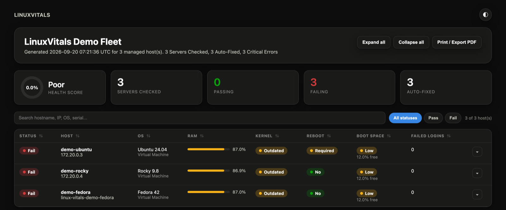
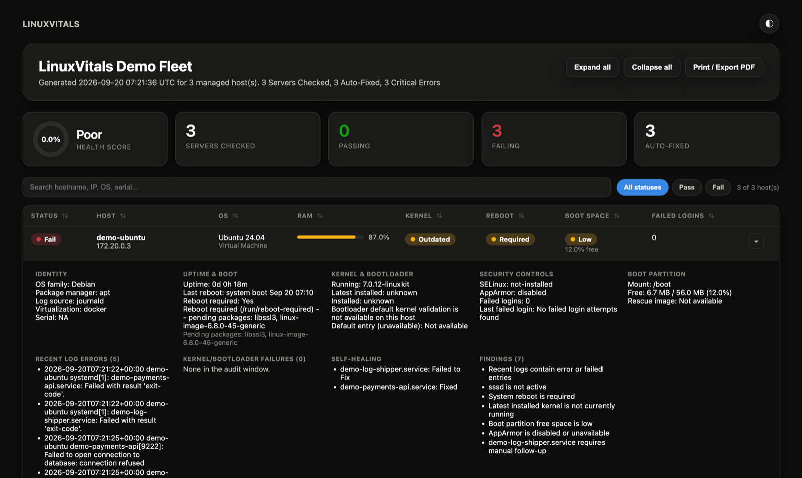

# Report Guide

LinuxVitals produces an HTML dashboard, a JSON report, and (when
baseline/postcheck snapshots exist) per-host JSON snapshots. Their default
paths are under `reports/` next to your inventory. Optional Prometheus
textfile and CSV exports are disabled until you configure their paths.

## HTML dashboard

`reports/linux_vitals_report.html` -- self-contained (no external CSS/JS,
no CDN), works offline, opens in any browser.

[](images/dashboard-overview.png)

The screenshots on this page come from the [demo fleet](../demo/README.md) and
are regenerated by `demo/screenshots.sh`, so they track the current templates.

**Header.** Report title, generated timestamp, and -- for `baseline` /
`postcheck` runs -- a phase badge and the maintenance id, so you can tell
at a glance which run you're looking at.

**KPI row.** Servers checked, a health-score ring (the percentage of hosts
that pass *and* had every check run, banded Excellent ≥95% / Good ≥80% /
Fair ≥60% / Poor <60%), passing/failing counts, hosts with unknown checks
(see [Status](#status-when-a-check-could-not-run)), and auto-fixed count. On a `postcheck` run, three more tiles
appear: Improved, Regressed, New hosts (hosts with no matching baseline
snapshot).

**Toolbar.** A free-text search box (matches hostname, IP, OS, and serial
number), status filter chips (All / Pass / Fail), and -- on `postcheck`
runs -- comparison filter chips (All / Regressed / Improved / New). Expand
all / Collapse all buttons and a Print / Export PDF button (uses the
browser's native print dialog; "Save as PDF" there gives you an offline
copy).

**Host table.** One row per host, sortable by clicking any column header
(click again to reverse). Click the chevron (or the row) to expand an
inline detail panel with everything the summary row doesn't show. A host
with checks that could not run carries an `N unknown` pill beside its
Pass/Fail status. Under each RAM meter, one line shows the host's saturation
signals ([#34](https://github.com/sameeralam3127/linux-vitals/issues/34)): the 5-minute load per CPU, the worst pressure stall
and the swap rate, each with a dot coloured by its status. `n/a` means not
measurable on that host (no PSI, or swap sampling off); `?` means the check
could not run.

- Identity (OS family, package manager, log source, virtualization type,
  serial number)
- Uptime and last reboot
- Kernel and bootloader validation (running vs. latest installed kernel,
  whether the default boot entry actually selects it)
- Security controls (SELinux/AppArmor status, failed login count and most
  recent attempt)
- Boot partition free space and rescue image availability
- Recent log errors and kernel/bootloader-related failures (with excerpts)
- Self-healing actions taken this run, with why any restart was not fixed.
  One that could not be verified is marked `unknown`
- Findings -- the specific reasons a host failed, if any. A check that could
  not run is marked `unknown`, followed by why
- On `postcheck` runs with a baseline available: status/RAM/kernel/reboot
  before vs. after, plus new and resolved findings

[](images/dashboard-host-detail.png)

**Theme.** Follows your OS light/dark preference by default; the toggle in
the top-right corner overrides it (stored via `localStorage` where
available). The print stylesheet forces a light, borderless layout
regardless of theme.

**Scaling to hundreds of hosts.** The table renders every host's row and
detail panel up front (search/filter/sort are pure client-side DOM
operations, no server round-trip), which keeps the file self-contained at
the cost of a larger HTML file for very large fleets. Search and filtering
keep the working view small even when the underlying table is large. What the
*run* costs at that size, and how to measure it, is in
[performance.md](performance.md).

## JSON report

`reports/linux_vitals_report.json` -- schema `2.1`, intended for ingestion
by log shippers, SIEMs, or your own dashboards.

```json
{
  "schema_version": "2.1",
  "generated_at": "20260712T120000Z",
  "report": { "title": "...", "html_output_path": "...", "json_output_path": "..." },
  "maintenance": { "phase": "postcheck", "maintenance_id": "2026-07-12-patch-window" },
  "summary": {
    "overall_status": "PASS",
    "servers_checked": 5,
    "auto_fixed_count": 1,
    "critical_error_count": 1,
    "health_score_pct": 80.0,
    "health_score_band": "Good",
    "unknown_host_count": 0,
    "comparison_active": true,
    "regressed_count": 1,
    "improved_count": 1,
    "new_hosts_count": 2,
    "snippet": "5 Servers Checked, 1 Auto-Fixed, 1 Critical Error"
  },
  "hosts": [
    {
      "inventory_name": "web01",
      "hostname": "web01",
      "ip_address": "192.0.2.11",
      "status": "Pass",
      "os": { "distribution": "Ubuntu 24.04", "family": "Debian", "package_manager": "apt", "log_source": "journald" },
      "platform": { "type": "Virtual Machine", "virtualization_type": "kvm", "uptime": "12d 4h 21m", "last_reboot": "2026-06-30 08:15" },
      "kernel": { "running": "6.8.0-60-generic", "latest_installed": "6.8.0-60-generic", "latest_selected": true, "install_failures": 0, "install_failure_excerpt": [] },
      "bootloader": { "supported": true, "default_status": "resolved", "default_matches_latest": true, "validation_message": "Default boot entry selects the latest installed kernel" },
      "reboot": { "required": false, "detection_supported": true, "source": "reboot-required-file", "pending_packages": [], "reason": "No reboot required (reboot-required-file)" },
      "security": { "selinux_status": "not-installed", "apparmor_status": "enabled", "failed_login_count": 0, "last_failed_login": "No failed login attempts found" },
      "boot_space": { "mount": "/boot", "free_pct": 65.3, "status": "Healthy", "rescue_image_available": true, "rescue_image_paths": ["..."] },
      "memory": { "status": "OK", "used_pct": 42.5, "used_mb": 3480.0, "total_mb": 8192.0 },
      "pressure": { "cpu_count": 4, "load": {"1m": 0.4, "5m": 0.36, "15m": 0.3}, "load_per_cpu": {"1m": 0.1, "5m": 0.09, "15m": 0.08}, "load_status": "OK", "psi_supported": true, "psi": {"cpu_some": 0.85, "memory_some": 0.0, "memory_full": 0.0, "io_some": 0.42, "io_full": 0.11}, "psi_status": "OK", "stalled": [], "swap_total_mb": 2048.0, "swap_used_mb": 0.0, "swap_used_pct": 0.0, "swap_sample_seconds": 2, "swap_in_per_sec": 0, "swap_out_per_sec": 0, "swap_rate_per_sec": 0, "swap_status": "OK", "load_reason": "", "psi_reason": "", "swap_reason": "" },
      "logs": { "error_count": 0, "excerpt": [] },
      "self_healing": { "services_healed": ["chronyd.service"], "healing_results": [{ "service": "chronyd.service", "result": "Fixed", "outcome": "fixed", "reason": "stayed_active", "detail": "it stayed active for 5 s after the restart" }] },
      "asset_serial": "VMware-56 4d 2a",
      "comparison": {
        "baseline_available": true,
        "status_before": "Fail",
        "status_after": "Pass",
        "status_improved": true,
        "status_regressed": false,
        "ram_used_pct_delta": -45.5,
        "kernel_changed": true,
        "new_findings": [],
        "resolved_findings": [
          {"id": "ram_critical", "message": "RAM usage is critical", "severity": "critical", "status": "fail"}
        ],
        "severity_before": "critical",
        "severity_after": "none"
      },
      "severity": "none",
      "severity_counts": {"info": 0, "warning": 0, "critical": 0},
      "unknown_count": 0,
      "findings": []
    }
  ]
}
```

Schema `2.1` is additive over `2.0`: every finding gains `status` (and
`reason` when the status is `unknown`), each host gains `unknown_count`, the
summary gains `unknown_host_count`, and each `healing_results` entry gains
`outcome`, `reason` and `detail`. Each host also gains `pressure`
([#34](https://github.com/sameeralam3127/linux-vitals/issues/34)). Nothing was removed or renamed, and no existing field changed
type or meaning.

`pressure` holds the CPU load, pressure stall and swap values the scan read,
and a status for each of the three checks:

- `load`, `load_per_cpu`: the 1, 5 and 15-minute load averages, raw and divided
  by `cpu_count` (online CPUs). `load_status` is judged on the 5-minute value.
- `psi`: PSI `avg60` percentages: the share of the last minute in which at least
  one task (`*_some`) or every task (`*_full`) was stalled on CPU, memory or I/O.
  `stalled` lists the resources at or above the warning threshold, worst first.
- `swap_*`: swap size and use, and the pages swapped in and out per second
  between two reads `swap_sample_seconds` apart.
- Each `*_status` is `OK`, `Warning` or `Critical` by threshold, or:
  - `Unknown`: it could not be read, and `*_reason` says why;
  - `Unsupported` (PSI): no PSI on this kernel; `psi` is `null` and `psi_reason` gives the kernel's answer;
  - `Not sampled` (swap): `linux_vitals_swap_sample_seconds` is `0`.

  A value that could not be measured is `null`, never `0`.

`comparison` is always present with at least `baseline_available`; on
`adhoc`/`baseline` runs, or for a host with no matching baseline snapshot,
it's `{"baseline_available": false}` and the rest of the comparison fields
are absent.

## Optional Prometheus textfile and CSV exports

Both exports use the current `linux_vitals_result_list` already assembled by
`vitals_report`. They run once on the Ansible controller, do no discovery,
and add no HTTP endpoint or additional host checks. The HTML and JSON outputs
keep their existing formats. Enable either export independently:

```yaml
linux_vitals_metrics_output_path: "/var/lib/node_exporter/textfile_collector/linux_vitals.prom"
linux_vitals_csv_output_path: "{{ inventory_dir }}/reports/linux_vitals_report.csv"
```

Both variables default to `""` (off). Use distinct paths for metrics, CSV,
HTML and JSON, and distinct paths for concurrent runs. Resolved export paths
that collide with each other or the HTML/JSON paths are rejected. The role
creates parent directories with `linux_vitals_report_dir_mode` and writes
files with `linux_vitals_report_file_mode`; defaults are `"0755"` and
`"0644"`. Give the automation user write access and the chosen reader access.
Exports overwrite their configured files on each run and are not archived or
pruned by the HTML/JSON archive settings. Disabling or changing an export path
does not delete its old file: remove obsolete exports explicitly.

### Prometheus textfile collector

The `.prom` file uses [Prometheus text exposition format 0.0.4](https://prometheus.io/docs/instrumenting/exposition_formats/),
with HELP/TYPE lines and no sample timestamps; it is not full OpenMetrics.
Configure an existing [node_exporter textfile collector](https://github.com/prometheus/node_exporter#textfile-collector)
on the controller to read the directory above, for example by adding
`--collector.textfile.directory=/var/lib/node_exporter/textfile_collector`
to its service command. This role does not install or configure node_exporter.
A Prometheus configuration for node_exporter running on that same machine is:

```yaml
scrape_configs:
  - job_name: linux_vitals_controller
    static_configs:
      - targets: ["localhost:9100"]
```

If Prometheus runs elsewhere, replace `localhost` with the controller's
reachable node_exporter address. The scrape target represents the controller;
the `host` label identifies the checked host. Per-host metrics have labels
`host`, `ip_address`, `os_family` and `phase`. Two results with the same
`(hostname, ip_address, os_family)` are rejected when metrics are enabled,
to avoid duplicate samples; CSV alone does not impose that identity check.

| Gauge | Meaning |
| --- | --- |
| `linux_vitals_host_status` | `1` only for `Pass` with zero unknown checks; otherwise `0`. |
| `linux_vitals_unknown_count` | Checks that could not run for this host. |
| `linux_vitals_findings_total` | Current findings by `severity` (`info`, `warning`, `critical`) and `status` (`fail`, `unknown`), including zero-valued combinations. Despite its suffix, this is a gauge, not a cumulative counter. |
| `linux_vitals_ram_used_pct` | RAM used percentage; `NaN` when unavailable. |
| `linux_vitals_reboot_required` | `1` required, `0` not required, `NaN` for an explicit unknown reboot finding or null reboot result. An unsupported distro-specific detector still uses the existing kernel fallback; unsupported alone does not mean `NaN`. |
| `linux_vitals_health_score_pct` | Fleet percentage of `Pass` hosts with zero unknown checks, rounded to one decimal; `0` for an empty fleet. Only the `phase` label is present. |

For example, a healthy host and the fleet score might emit:

```text
# HELP linux_vitals_host_status 1 when the host passes and every check could run, otherwise 0.
# TYPE linux_vitals_host_status gauge
linux_vitals_host_status{host="web01",ip_address="192.0.2.11",os_family="Debian",phase="adhoc"} 1
# HELP linux_vitals_health_score_pct Percentage of hosts that pass with no unknown checks in this report.
# TYPE linux_vitals_health_score_pct gauge
linux_vitals_health_score_pct{phase="adhoc"} 100.0
```

These are run snapshots, not continuously refreshed host measurements.
Prometheus scrape time does not establish when the scan ran. Monitor
node_exporter's `node_textfile_mtime_seconds` for the file and alert on an age
appropriate to your scan schedule. An old `.prom` file remains scrapeable if a
run fails or metrics are disabled; remove it explicitly when retiring the
export. Phase is a label, so a new run with another phase replaces the file's
previous phase samples rather than preserving history in the file.

### CSV fleet table

The CSV has one header and one row per host, in this fixed 22-column order:

```text
status,unknown_count,hostname,ip_address,os,os_family,platform_type,phase,ram_used_pct,load_per_cpu_5m,load_status,psi_some_max_pct,psi_status,swap_rate_per_sec,swap_status,kernel_status,reboot_required,reboot_detection_supported,boot_space_status,boot_free_pct,failed_login_count,change
```

Missing optional measurements are blank, not zero. Pressure status columns
retain values such as `Unknown`, `Unsupported` and `Not sampled`.
`psi_some_max_pct` is the largest CPU, memory or I/O `some` percentage.
`kernel_status` is `Current` or `Outdated`; `reboot_required` is `Required`,
`No` or `Unknown`, and `reboot_detection_supported` is `true` or `false`.
`change` is blank outside `postcheck`; during `postcheck` it is `New`,
`Regressed`, `Improved` or `Unchanged` according to the existing comparison.

Every cell is double-quoted and embedded quotes are doubled, so commas,
quotes and line breaks in text remain within one cell. Text starting with
`=`, `+`, `-`, `@`, tab, carriage return or newline receives a leading
apostrophe to prevent spreadsheet formula interpretation. This protection
intentionally changes those text cells and is not reversible without knowing
the original value. Use the JSON report when exact original strings are
needed. Numeric values do not receive the prefix. Use a CSV parser rather
than splitting on commas or lines.

## Self-healing outcomes

When `vitals_heal` is enabled, each restart it attempts is one entry in
`self_healing.healing_results`. A restart is not judged from one look:
each unit is polled until it is active, failed or inactive, and a unit that
came up must still be active, on the same run, after
`linux_vitals_heal_stability_seconds` (see
[configuration-reference.md](configuration-reference.md#self-healing)).

```json
{"service": "app.service", "result": "Failed to Fix", "outcome": "still_failed", "reason": "failed", "detail": "it came up, then failed within 5 s (result: exit-code)"}
```

`result` has the same three values it always had, so code that reads only
`result` still reads every entry correctly: only a verified fix is `Fixed`.
`outcome` says which of three states the attempt ended in, and `reason` why:

| `result` | `outcome` | `reason` | Means |
| --- | --- | --- | --- |
| `Fixed` | `fixed` | `stayed_active` | Active after the restart and still on the same run after the stability window |
| `Failed to Fix` | `still_failed` | `failed` | Failed again: at once, within the stability window, or because its start job failed and the restart command reported it (`detail` then says so) |
| `Failed to Fix` | `still_failed` | `restarted_during_check` | Active at both looks, but systemd restarted it in between: it crashed and its `Restart=` policy brought it back |
| `Manual Intervention Required` | `still_failed` | `restart_error` | The restart command failed without leaving a failed unit behind -- the unit was not found, or its state could not be read. `detail` carries the error |
| `Manual Intervention Required` | `still_failed` | `inactive` | It is not running after the restart, but did not fail either |
| `Manual Intervention Required` | `unknown` | `not_settled` | Still activating, deactivating or reloading when the settle budget ran out |
| `Manual Intervention Required` | `unknown` | `check_failed` | Its state could not be read after the restart |

`unknown` means the check could not complete, so nobody knows whether the
restart worked. It is never reported as `Fixed`, and its
`service_manual_followup` finding has `status: unknown` with `detail` as its
`reason`. `detail` is a sentence for a human and may be reworded in any
release; join on `reason`. An entry written before 2.2.0 has only `service`
and `result`.

`auto_fixed_count` and `services_healed` count `Fixed` entries only.

## Findings

What to *do* about each of these is in the [Operator Runbook](runbook.md).

Every finding is an object with a stable `id`, a human `message`, a
`severity`, and a `status`:

```json
{"id": "reboot_required", "message": "System reboot is required", "severity": "warning", "status": "fail"}
```

The `id` is the durable one. It is what severity is keyed on and what an
external system should join against -- `message` wording can change in any
release without that being a breaking change.

A finding that can occur more than once on a host also carries `subject`: the
unit for the self-healing finding, the path or `host:port` for certificate
findings. An id alone is therefore not unique within a host -- join on
`(id, subject)`, treating a missing `subject` as empty. That pair is what the
baseline/postcheck comparison diffs on, so a service that newly fails while
another was already failing is reported as new.

### Status: when a check could not run

A finding's `status` says which of two things it records:

| `status` | Means | Extra field |
| --- | --- | --- |
| `fail` | The check ran and found something wrong | -- |
| `unknown` | The check could not run, so nothing is known either way | `reason`: why, e.g. `lastb unavailable` |

```json
{"id": "failed_logins", "message": "Failed-login history could not be read", "severity": "info", "status": "unknown", "reason": "lastb unavailable"}
```

A check that ran and found nothing raises no finding at all, so there is no
`pass` status. A finding without a `status` -- from a snapshot written
before 2.2.0 -- means `fail`.

An `unknown` finding is classified and counted like any other, so under the
default `linux_vitals_fail_on_severity` it fails the host: a host nobody
could fully check is not reported as clean. Each host's `unknown_count` says
how many of its checks could not run, and the summary's `unknown_host_count`
how many hosts had at least one. Those hosts never count towards the health
score, even when a raised threshold lets them pass.

### Severity

| Severity | Meaning |
| --- | --- |
| `critical` | Something is broken now, or you are blind to it |
| `warning` | Something will break, or a control you rely on is off |
| `info` | Worth seeing, too noisy to page on |

A host's `severity` is the highest severity among its findings, or `none`
when it has none. `severity_counts` breaks the same findings down by level,
and the report `summary` carries `hosts_by_severity` (each host counted once,
at its highest level, so the numbers partition the fleet) and
`findings_by_severity` (every finding counted).

### What each finding means, and how it is classified

| id | Severity | Fires when |
| --- | --- | --- |
| `ram_critical` | critical | RAM usage at or above `linux_vitals_ram_critical_threshold` |
| `journald_inactive` | critical | `systemd-journald` is not running -- the host's own logging is down |
| `service_manual_followup` | critical | A self-healing attempt did not end in `Fixed`. `unknown` when the restart could not be verified -- see [Self-healing outcomes](#self-healing-outcomes) |
| `sssd_inactive` | warning | `sssd` is not running |
| `time_sync_absent` | warning | No `chronyd`/`ntp` service is installed |
| `time_sync_inactive` | warning | The resolved time-sync service is not running |
| `reboot_required` | warning | Per-distro reboot detection fired -- see [kernel-reboot-detection.md](kernel-reboot-detection.md) |
| `kernel_not_latest` | warning | The running kernel is not the latest installed one |
| `bootloader_mismatch` | warning | The default boot entry does not select the latest installed kernel |
| `boot_space_low` | warning | Boot partition free space below `linux_vitals_boot_warning_threshold` |
| `kernel_install_failures` | warning | Kernel/bootloader failures in the audit log window |
| `selinux_disabled` | warning | SELinux disabled/unavailable on a RedHat-family host |
| `apparmor_disabled` | warning | AppArmor disabled/unavailable on a Debian-family host |
| `cpu_load_high` | warning or critical | 5-minute load average per online CPU at or above `linux_vitals_load_warning_threshold` (warning) or `linux_vitals_load_critical_threshold` (critical). `unknown` when the load or CPU count could not be read |
| `pressure_stall_high` | warning or critical | One per resource (`subject`: `cpu`, `memory` or `io`) whose PSI `some avg60` is at or above `linux_vitals_psi_warning_threshold` / `linux_vitals_psi_critical_threshold`. Nothing on a kernel without PSI; `unknown` when the probe could not run |
| `swap_paging_high` | warning or critical | Pages swapped in plus out per second, over `linux_vitals_swap_sample_seconds`, at or above `linux_vitals_swap_rate_warning_threshold` / `linux_vitals_swap_rate_critical_threshold`. `unknown` when the counters could not be read |
| `log_errors` | info | The journal has entries at priority `linux_vitals_log_priority` (default `err`) or worse in the log window |
| `failed_logins` | info | Recent failed login attempts were detected |

The three saturation findings ([#34](https://github.com/sameeralam3127/linux-vitals/issues/34)) also carry their own severity,
from the threshold the value crossed. The map entry for each (`warning`) is
only what an `unknown` one gets, and `linux_vitals_finding_severity_overrides`
still overrides both.

Certificate findings, from the opt-in `vitals_certs` role. Their severity is
computed rather than looked up, because it depends on the certificate rather
than on the finding type:

| id | Severity | Fires when |
| --- | --- | --- |
| `cert_expired` | critical | A certificate's `notAfter` is in the past |
| `cert_expiring` | critical / warning | Days remaining at or below `linux_vitals_cert_critical_days` / `..._warning_days` |
| `cert_weak_signature` | warning | The signature algorithm matches `linux_vitals_cert_weak_signature_algorithms` |
| `cert_self_signed` | warning | A **served** certificate is self-signed (self-signed files on disk are not flagged; CA roots are self-signed by definition) |
| `cert_weak_tls_version` | warning | An endpoint negotiated below `linux_vitals_cert_minimum_tls_version` |
| `cert_served_not_on_disk` | warning | The served certificate's fingerprint matches nothing on disk -- typically a service that was never reloaded after renewal |
| `cert_endpoint_unreachable` | warning | An endpoint could not be reached or did not complete a handshake |
| `cert_scan_unavailable` | info | No `openssl` binary on the host, so nothing could be parsed |

A host that ran `vitals_certs` also carries a `certificates` object
(`certificates_found`, `endpoints_checked`, `expired`, `soonest_expiry_days`,
`openssl_available`, `scanned_paths`). It is **omitted entirely** when the role
did not run, so a consumer can tell "no certificate scan" from "scanned, found
nothing".

`log_errors` and `failed_logins` are `info` because both occur on healthy
hosts as a matter of course; they are counts worth seeing, not events worth
paging on.

The counts behind `log_errors` and `kernel_install_failures`
(`logs.error_count` and `kernel.install_failures` in the JSON) stop at
`linux_vitals_log_max_lines` (default `2000`): each journal scan returns at
most that many lines, the newest ones, so a count equal to the cap means at
least that many. Each excerpt is the first five of those lines, oldest first.

### Retuning severity, and what makes a host fail

Severity is a judgement about your estimate, so it is configurable. Override
individual findings rather than replacing the whole map -- a replaced map
means findings added in a later release have no entry and fall back to
`warning`:

```yaml
linux_vitals_finding_severity_overrides:
  apparmor_disabled: info       # we do not run AppArmor
  reboot_required: critical     # our change window is tight
```

`final_status` is `Fail` when a host has at least one finding at or above
`linux_vitals_fail_on_severity`:

```yaml
linux_vitals_fail_on_severity: warning
```

The default is `info`, which means **any** finding fails the host -- the
behaviour of every release before severity existed. Raising it is what turns
severity into triage: the host still reports every finding, and its
`severity` still reflects the worst of them, but only findings at or above
the threshold count against it. Because `final_status` drives the fleet
health score, raising the threshold raises the score -- except for hosts
with an unknown check, which never count as healthy.

An unrecognised value falls back to failing on anything, so a typo in
`group_vars` cannot silently pass a broken fleet.

## The Slack message

Sent as [Block Kit](https://api.slack.com/block-kit) whenever a Slack webhook
URL resolves. The shape, top to bottom:

| Part | Content |
| --- | --- |
| Preview line | One short line above the card: `LinuxVitals: FAIL -- 3 host(s) checked, 1 critical, 0 auto-fixed` |
| Colour bar | Green when everything passed, amber when the worst host severity is `warning`, red when there are critical errors or a critical-severity host |
| Header | `linux_vitals_slack_message_header` (default `LinuxVitals Health Check`) |
| Verdict | `PASS`/`FAIL` with an emoji, then the one-line snippet |
| Counters | Servers checked, auto-fixed, critical errors, health score -- laid out in two columns |
| Findings roll-up | Counts by severity, for findings and for hosts |
| Needs attention first | Up to 5 critical hosts, each with up to 3 of its critical findings |
| Host breakdown | A fixed-width table: host, status, severity, kernel, bootloader, reboot, `/boot`, failed logins |
| `+ N more` | Shown whenever the host cap applied |
| Footer | `LinuxVitals · N host(s) scanned`, plus `linux_vitals_slack_message_footer` if set |

The breakdown is a table in a code block:

```text
HOST          STATUS  SEV   KERNEL         BOOTLDR  REBOOT  /BOOT    LOGINS
------------  ------  ----  -------------  -------  ------  -------  ------
web-01        Fail    CRIT  6.8.0-generic  latest   yes     Low      0
db-04         Pass    WARN  6.8.0-generic  latest   no      Healthy  2
```

Slack has no table primitive, so a code block is the only way to get columns
that line up. It is also one block rather than one per host, which is what
keeps a large fleet inside the 50-block limit. `BOOTLDR` collapses the
bootloader state to `latest`, `NOT latest`, `unresolved`, or `n/a`; the full
detail is in the HTML dashboard and the JSON report.

**Why the preview line is short.** Slack renders the top-level `text` field
*above* the attachment -- it is only a silent fallback when `blocks` sit at the
top level, which they do not here because the colour bar needs an attachment.
Putting the full plain-text summary there printed the entire old-style message
above the new card. The preview is also what the mobile push shows, which is
why it leads with the verdict.

The verdict word is derived exactly as the plain-text message and the generic
webhook derive it (`PASS` when `critical_error_count` is zero), so the three
can never disagree. Severity only chooses the colour.

**Ordering and the cap.** Hosts are sorted worst-first -- critical, warning,
info, then everything else -- and only the first `linux_vitals_slack_max_hosts`
(default 10) are rendered. The cap therefore drops the hosts with nothing
wrong. This is not cosmetic: Slack rejects a message over 50 blocks or 40,000
characters, and it rejects it with a bare HTTP 400 that names no cause, which
`no_log` then makes harder to diagnose. The cap is clamped to 30 at render
time regardless of what the variable is set to.

**The plain-text message still exists.** `slack_message.txt.j2` is unchanged
and is still what the email body and the generic webhook's `message` field
carry. It is no longer sent to Slack, because Slack would render it above the
card.

## Generic webhook payload

Sent as a JSON POST body when `linux_vitals_generic_webhook_enabled: true`
and a URL resolves:

```json
{
  "summary": { "header": "...", "overall_status": "PASS", "servers_checked": 5, "auto_fixed_count": 1, "critical_error_count": 1, "snippet": "..." },
  "message": "<the same text sent to Slack>",
  "hosts": [
    { "hostname": "web01", "ip_address": "192.0.2.11", "status": "Pass", "platform_type": "Virtual Machine", "uptime": "12d 4h 21m", "running_kernel": "6.8.0-60-generic", "latest_kernel_selected": true, "reboot_required": false, "boot_space_status": "Healthy", "failed_login_count": 0, "unknown_count": 0, "findings": [] }
  ]
}
```

## Snapshots

`reports/snapshots/<maintenance_id>/<phase>/<hostname>.json` -- one file
per host per phase, written whenever `linux_vitals_phase` is `baseline` or
`postcheck`. Each file is exactly that host's `linux_vitals_result` object
at snapshot time (schema matches a single entry in the JSON report's
`hosts` array, minus the top-level `comparison` enrichment). These aren't
pruned automatically -- clean them up per your own retention policy if you
run many maintenance windows.

Beside them, `.shards/<shard>.json` records which hosts each run of that
phase covered: `maintenance_id`, `phase`, `shard` (`default` when
`linux_vitals_snapshot_shard` is empty), the sorted `hosts`, and
`recorded_at`. It is written once, by the first run of that shard, and is
what lets a later run reusing the shard id for other hosts be refused. See
[Sharding a large fleet](performance.md#sharding-a-large-fleet).

## Unreadable system journals

`log_errors` and `kernel_install_failures` report `status: unknown` with a
`reason` when the system journal cannot be inspected: journal access is denied,
`journalctl` fails (including an invalid time window), or the host does not use
systemd. An empty successful system-journal read remains clean. These scans use
`--system`; a user's partial journal is not evidence of a clean host.

Without `become`, grant the automation user access to the system journal or
expect unknown findings. Unknown findings contribute to `unknown_count` and are
excluded from the healthy-host score even when a raised severity threshold lets
the host pass. Legacy log-count fields count matched lines only; zero is not a
successful check when the corresponding finding is unknown.
